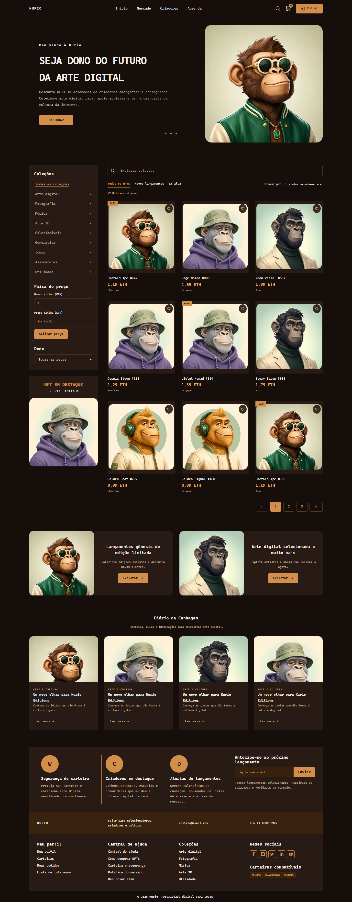

# KURIO — Marketplace de NFTs

Marketplace responsivo desenvolvido como desafio frontend em React e TypeScript, com descoberta de NFTs, compra e gerenciamento da conta do colecionador. Interface baseada no design fornecido no Figma, com fluxos desktop e mobile.

**[Acessar aplicação](https://kurio-marketplace-five.vercel.app/)** · [Repositório](https://github.com/PedroAragaoDev/kurio-marketplace) · [Arquitetura](ARCHITECTURE.md) · [Resultados de validação](docs/05-VALIDACAO.md)

APIs, autenticação, carteiras e pagamentos são simulados com MSW na camada de rede, conforme o escopo do desafio. A aplicação não exige backend privado, extensão de carteira ou dinheiro real.

## Explorar o projeto

As contas abaixo estão disponíveis na aplicação publicada e na execução local:

| Conta | E-mail | Senha inicial |
| --- | --- | --- |
| Ana Silva | ana@kurio.test | Colecionador!2026 |
| Bruno Costa | bruno@kurio.test | Colecionador!2026 |

Para uma primeira avaliação:

1. Explore o catálogo, combine filtros e abra o detalhe de um NFT.
2. Adicione itens ao carrinho, ajuste as quantidades e teste o cupom `KURIO10`.
3. Entre com uma conta, selecione uma carteira e revise a compra até o recibo.
4. Confira perfil, carteiras e favoritos; recarregue as páginas para verificar a persistência.
5. Use o [painel de cenários](https://kurio-marketplace-five.vercel.app/demonstracao) para avaliar falhas e recuperação conforme as instruções abaixo.

Os dados persistem neste navegador e domínio; a execução local e o site publicado têm estados independentes. Use apenas dados fictícios. O reset restaura as contas e senhas iniciais.

<details>
<summary>Ver prévia da página inicial em desktop</summary>



Captura local utilizada na regressão visual; não representa uma verificação do deploy.

</details>

## Funcionalidades

- **Catálogo:** busca, filtros combinados, ordenação e paginação na URL, com restauração após refresh e navegação pelo histórico.
- **NFT e favoritos:** detalhe por acesso direto, seleção de edição/quantidade e favoritos com atualização otimista e rollback.
- **Carrinho e compra:** persistência, cupons, cotação revalidada, revisão, pedido idempotente e recibo com snapshot dos valores.
- **Conta:** cadastro, login, retomada após expiração de sessão, edição de perfil/avatar/senha e gerenciamento de carteiras.
- **Tempo real e recuperação:** atualização de preço/disponibilidade e estado do pedido via Socket.IO, com reconciliação REST após reconexão.
- **Interface:** layouts responsivos, skeletons, feedback de erros, navegação por teclado e controle de foco em diálogos.

## Stack

| Responsabilidade | Tecnologias |
| --- | --- |
| Interface e build | React, TypeScript e Vite |
| Rotas e estado remoto | TanStack Router e TanStack Query |
| REST e validação | Axios e Zod |
| Estilização e componentes | Tailwind CSS e componentes shadcn/ui adaptados com Radix UI |
| Simulação e eventos | MSW e socket.io-client |
| Testes e auditoria | Vitest, Playwright e Lighthouse |

## Executar localmente

Requisitos: **Node.js 22.12 ou superior**, npm e Git. A partir de um checkout limpo:

```sh
git clone https://github.com/PedroAragaoDev/kurio-marketplace.git
cd kurio-marketplace
npm ci
npm run dev
```

Abra a URL informada pelo Vite. O desenvolvimento e o build funcionam com os mocks habilitados por padrão, sem serviços privados.

### Variáveis de ambiente

| Variável | Valor para este projeto | Comportamento |
| --- | --- | --- |
| `VITE_ENABLE_MOCKS` | `true` | Ativa as APIs e os eventos simulados no desenvolvimento e no build publicado |

O arquivo [.env.example](.env.example) documenta a configuração. Não é necessário criar um `.env` para executar com os valores padrão. Definir `VITE_ENABLE_MOCKS=false` exige uma implementação externa dos contratos REST e Socket.IO, que não faz parte desta entrega.

### Build e preview

```sh
npm run build
npm run preview
```

O build é gerado em `dist/`. Abra o endereço informado pelo preview para conferir a versão otimizada.

## Cenários e recuperação de falhas

Abra `/demonstracao` **na mesma aba** da aplicação, local ou publicada. O painel técnico permite selecionar condições de rede/pagamento e disparar eventos; ele não aparece no rodapé do marketplace.

O seletor oferece **Padrão**, **Lentidão**, **Respostas fora de ordem**, **Falha de conexão**, **Erro HTTP 503**, **Sessão expirada**, **Conflito de cadastro**, **Falha ao favoritar**, **Pagamento recusado**, **Timeout após criar pedido** e **Pedido pendente**.

Para voltar ao estado inicial, use **Restaurar demonstração**. Isso limpa cenário, usuários cadastrados, alterações de perfil, carrinhos, favoritos, carteiras, cotações e pedidos, restaurando as fixtures iniciais. A ação afeta os dados locais deste navegador e domínio.

### Roteiros de reprodução

| Cenário | Como reproduzir e o que observar |
| --- | --- |
| Cupom | No carrinho, aplique `KURIO10` para 10% de desconto sobre o subtotal; `EXPIRED` reproduz cupom expirado e outros códigos são inválidos. |
| Lentidão e erro de rede | Selecione **Lentidão**, **Falha de conexão** ou **Erro HTTP 503** e retorne ao catálogo. Observe carregamento ou feedback de erro; volte a **Padrão** e tente novamente. |
| Respostas fora de ordem | Selecione **Respostas fora de ordem**, retorne ao catálogo e altere rapidamente a busca. O resultado deve corresponder à consulta mais recente. |
| Conflito de cadastro | Selecione **Conflito de cadastro** e envie um novo cadastro com campos válidos. A API deve retornar o conflito, apresentado no formulário. |
| Pagamento recusado | Selecione **Pagamento recusado** e conclua uma tentativa de compra. O pedido deve ser recusado e os itens preservados no carrinho. |
| Preço ou estoque alterado | Adicione `Emerald Ape #042` e avance até a revisão. Abra o painel na mesma aba e use **Alterar preço** ou **Esgotar edição**. Retorne a `/pagamento`: o checkout deve exigir nova revisão ou a correção do item indisponível. |
| Timeout e idempotência | Selecione **Timeout após criar pedido**, confirme a compra e use **Recuperar tentativa**, inclusive após refresh. A tentativa deve recuperar o mesmo pedido. |
| Pedido pendente e reconexão | Selecione **Pedido pendente**, confirme a compra e guarde a URL do pedido. Abra o painel na mesma aba, use **Desconectar**, **Concluir pendente** e **Reconectar**. Retorne à URL do pedido ou recarregue essa rota para recuperar seu estado. |
| Rollback de favoritos | Selecione **Falha ao favoritar** e acione o coração de um NFT. A alteração otimista deve ser revertida após o erro. |
| Sessão expirada | Com a conta autenticada, use **Expirar sessão** no painel e retorne a uma tela privada. Entre novamente para retomar o fluxo. |
| Isolamento de contas | Salve favoritos em Ana, saia e entre como Bruno. Os dados privados de Ana não devem aparecer na conta de Bruno. |

Os comandos do painel alteram a API simulada e emitem eventos interceptados pelo MSW. A interface recebe os eventos pelo cliente Socket.IO; os testes de checkout também disparam os endpoints técnicos enquanto o resumo permanece aberto, verificando a atualização em tempo real.

## Testes e qualidade

| Comando | Finalidade |
| --- | --- |
| `npm run typecheck` | Verificar os tipos TypeScript |
| `npm run lint` | Verificar as regras de código |
| `npm test` | Executar os testes unitários |
| `npx playwright install chromium` | Instalar o navegador necessário para os E2E |
| `npm run test:e2e` | Executar os fluxos E2E em Chromium desktop e mobile |
| `npm run test:visual` | Comparar início, detalhe, carrinho e pagamento com as baselines versionadas |
| `npm run audit:lighthouse` | Auditar início e detalhe em mobile/desktop; executar `npm run build` antes |

O Playwright compila a aplicação e inicia o preview em `127.0.0.1:4182`. Cada teste usa um contexto isolado, com REST passando pelos handlers MSW e eventos pelo cliente Socket.IO sobre WebSocket. O relatório HTML é gerado em `playwright-report/`; screenshots e traces de falhas ficam em `test-results/`.

As baselines de `tests/e2e/visual.spec.ts-snapshots/` dependem da versão do Chromium e do sistema operacional. Para atualizar referências após uma alteração visual intencional, execute `npm run test:visual -- --update-snapshots` e revise as imagens antes do commit.

O script Lighthouse inicia o preview em `127.0.0.1:4181`, com Chromium na porta de depuração 9223. São três medições por página/perfil: doze relatórios HTML/JSON em `audit-results/`, com medianas, versões, ambiente, LCP, CLS e TBT em `summary.json`. Os perfis usam os presets mobile Slow 4G e desktop Dense 4G.

Consulte os **[resultados, relatórios e limitações das verificações](docs/05-VALIDACAO.md)**. O documento distingue as execuções locais e suas versões, registra falhas intermitentes ainda sem causa confirmada e a mediana de Performance 89 no início mobile, abaixo da meta 90. As medições Lighthouse registradas precedem os últimos ajustes visuais.

## Organização do código

| Diretório | Responsabilidade |
| --- | --- |
| `src/pages` e `src/components` | Telas e componentes da interface |
| `src/hooks` | Coordenação de sessão, eventos, carrinho e compra |
| `src/contracts` | Schemas e tipos de transporte |
| `src/lib` | Cliente HTTP, cache e cálculos monetários |
| `src/mocks` | Handlers MSW, fixtures, persistência e regras da API simulada |
| `tests` | Testes unitários, E2E e baselines visuais |
| `scripts` | Automação de auditoria |
| `docs` | Design, critérios de aceite, contratos, validação e publicação |

## Design, decisões e limites

As referências recebidas estão em `Frontend Challenge/`. Quatro artworks foram extraídos da exportação local e preservados em `public/art/`; a interface usa versões WebP de aproximadamente 65 KB no total, em comparação com 831 KB dos recortes PNG.

A família original da fonte não veio na exportação. O projeto utiliza fonte monoespaçada do sistema e medidas aproximadas a partir das imagens fornecidas. As substituições de assets, adaptações de acessibilidade e decisões de UX estão registradas em [ARCHITECTURE.md](ARCHITECTURE.md); não se declara fidelidade pixel a pixel. As atribuições dos componentes adaptados estão em [THIRD_PARTY_NOTICES.md](THIRD_PARTY_NOTICES.md).

A persistência da simulação é local ao navegador, sem sincronização entre abas ou dispositivos. Senhas recebem salt aleatório e PBKDF2/SHA-256, mas o ambiente continua inspecionável e não substitui autenticação de produção. O transporte simulado cobre o subconjunto textual do namespace padrão Socket.IO; suas limitações estão documentadas na arquitetura.

## Publicação

A aplicação está publicada na **[Vercel](https://kurio-marketplace-five.vercel.app/)** com os mocks habilitados. A configuração de build e fallback de rotas está em `vercel.json`. Para reproduzir o deploy, consulte o [guia de publicação](docs/06-PUBLICACAO.md).

## Documentação complementar

| Documento | Conteúdo |
| --- | --- |
| [Arquitetura](ARCHITECTURE.md) | Sessão, carrinho, cache, retries, idempotência, REST/Socket.IO e decisões de UX |
| [Mapeamento do design](docs/01-MAPEAMENTO-DO-DESIGN.md) | Referências visuais e composição das telas |
| [Critérios de aceite](docs/02-CRITERIOS-DE-ACEITE.md) | Correspondência entre requisitos e implementação |
| [Decisões e pendências](docs/03-DECISOES-E-PENDENCIAS.md) | Registro das decisões e pontos identificados durante o desenvolvimento |
| [Contratos REST e eventos](docs/04-CONTRATOS.md) | Recursos, payloads e eventos utilizados |
| [Validação e evidências](docs/05-VALIDACAO.md) | Testes executados, relatórios, auditorias e limites conhecidos |
| [Publicação](docs/06-PUBLICACAO.md) | Passo a passo de configuração e conferência do deploy |
